# 川农口袋 · 四川农业大学校园助手

一个为四川农业大学（SICAU）同学做的轻量校园 App，用一套 TypeScript 代码写出来，目前**只提供 Android 版本**（另有 Web 版可在浏览器预览）。

> ⚠️ **暂不支持 iOS**：仓库里没有任何 iOS 构建产物，也没有 App Store 版本。代码本身是跨平台的（Expo + React Native），
> 但 iOS 端还需要 Apple 开发者账号（$99/年）+ 真机签名才能装，这部分**没有做**。iPhone 同学请先用 Web 版，或等后续适配。

产品思路参考了郑州大学的开源项目 [ZZUPocket](https://github.com/3beuml/ZZUPocket)（Kotlin + Jetpack Compose），本项目用 Expo + React Native 重写，并换成川农的作息、学期与信息架构。

## 功能

| 模块 | 说明 |
| --- | --- |
| 今天 | 聚合首页：现在上什么课、还有多久下课、今日时间轴（右上角「去课表看」直达课表）、快捷入口、专注统计 |
| 课表 | 10 节次网格（08:10 起，按官方作息）、上午/下午/晚上分组、7 天横向滚动、单双周 / 多时段 / 自定义课程、周次切换、**非本周课程灰底占位** |
| 专注 | 番茄钟（15/25/45/60 分钟）、标签、暂停/继续、今日记录、17 周热力图、连续天数 |
| 我的 | 身份绑定、校区切换、校园服务入口、设置 |
| 课表导入 | **账号登录 / 课表链接 / 网页源码** 三种方式，把教务系统的真实课表解析进本机 |
| 空闲教室 | 教务真实课表（211 间教室），按教学楼 / 时段查询，每周可重新同步 |
| 成绩查询 | 在 App 内置浏览器里登录教务系统，进到「成绩查询」后一键导入，自动算加权平均分 / 平均绩点 / 挂科数 |
| 校历 | 教务网校历原图（含作息/节假日/报到时间，可放大）+ 按开学日期推算的周历 |
| 校园服务 | 电费 · 一卡通（学校一卡通 H5，真实余额/流水/充值）、空闲教室（教务真实课表）、成绩查询、校历 |
| 外观 | 浅色 / 深色 / 跟随系统，全套自绘主题 |


课表页把**同一门课连着的节次合成一块**（例如 4 学时的课在教务系统里排成 1-2 节 + 3-4 节两格，App 里显示为一块「第 1-4 节」）；只在「同课程 + 同一时段（不跨午休）+ 节次紧挨 + 同一教室」时才合并。

## 桌面小组件（Android）

长按桌面空白处 → **小组件** → 找到「川农口袋」，里面有 **两种尺寸**：

| 尺寸 | 名称 | 显示内容 |
| --- | --- | --- |
| 4×2 | 川农课表 | 顶部日期药丸 + 今天前 3 节（彩色竖条 + 彩色课程名 + 时间/教室），底部「其他 N 个日程」 |
| 2×2 | 川农课表（小） | 顶部日期药丸 + 只显示 **正在上 / 下一节** 这一门：彩色竖条、课程名、时间与教室 |

共同细节：卡片是浅色雾面 + 22dp 圆角；右下角/右上角有一枚约占卡面 1/3 的淡校徽水印（alpha 0.10，故意做出「压在卡片下面」的层次感）；每门课按课程配色取一条竖条与课程名颜色；今天没课时显示「今天没课，好好休息」；正在上课时状态行写「正在上」；「刷新」可手动重读；点卡片任意处打开 App；系统每 30 分钟自动刷新。

实现方式（`plugins/withScheduleWidget.js`）：

| 部分 | 做法 |
| --- | --- |
| 小组件本体 | 两个原生 `AppWidgetProvider`（Kotlin + `RemoteViews`），纯原生、不依赖 RN 运行时 |
| 数据桥 | App 每次课表/设置变化时，`lib/widgetSync.ts` 把「今天要显示的课」写成 `filesDir/widget.json`；两个小组件都读这个文件 |
| 小尺寸取哪一门 | payload 里额外带一个 `highlight`（正在上的课，或下一节），小尺寸只渲染它 |
| 为什么不直接读 AsyncStorage | 小组件跑在系统进程里，拿不到 RN 的存储；写文件是最稳的桥 |
| 刷新时机 | 系统 30 分钟一次（`updatePeriodMillis`）+ 点「刷新」+ 打开 App |

踩过的坑：`RemoteViews` 只允许白名单里的控件，布局里用 `<View>` 当色条或占位符会直接 `InflateException: Class not allowed to be inflated android.view.View`，
系统小组件选择器里表现为「Can't load widget」。所有色条/占位都要用 `<TextView>`（或 `ImageView`）代替。

之所以做成 config plugin 而不是直接改 `android/`：`android/` 是 `expo prebuild` 生成物、被 `.gitignore` 忽略，
插件会在每次 prebuild 时把 Kotlin 源码、两个布局、`appwidget-provider` 配置和 `AndroidManifest` 里的两个 `<receiver>` 重新注入。

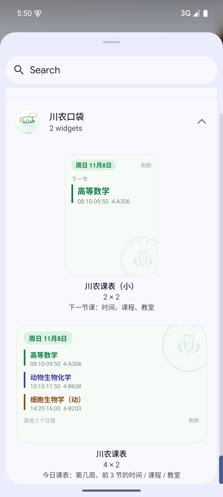

## 校园卡 / 电费（真实数据，v0.8.0）

学校给学生的入口是微信里的 H5：`https://yktwechat.sicau.edu.cn/home/openHomePage?openid=…`。
实测这个页面**只要带上 openid 就能直接渲染**（与 UA 无关、不需要微信 JSSDK），余额、流水、
校园卡充值、电费充值都在里面。

所以「我的 → 校园一卡通 / 宿舍电费」进的是 App 内的「校园卡」页：

1. 在微信「智慧川农 → 一卡通服务」里打开一次，点右上角「…」→「复制链接」；
2. 把整段链接粘到 App 里绑定（只需要做一次）；
3. 之后 App 内直接显示真实余额 + 学校的一卡通页面，可以直接充宿舍电费。

拿到 openid 的正确姿势（微信小程序内嵌页，复制链接不一定给）：
进「电费充值」页 → 右上角「…」→「用其他应用打开」→ 选 Safari / Chrome → 复制地址栏里 `openid=` 后面那串。

openid 只存在本机 AsyncStorage，不上传、不进日志。想解绑在页面里点「解除绑定」。

**电费房间记忆**：进「电费充值」后选一次「校区 → 楼栋 → 楼层 → 房间」，App 会把四个值记下来，
下次进这个页面自动按顺序填回去（注入 JS 依次触发 change，等上一级选项加载完再填下一级），
就不用每次点四次下拉。卡片上会显示记住的房间名。

> 顺带记一下：`elec.sicau.edu.cn`（ECMS）是后勤侧的电控系统，登录是「用户名 + 密码」的
> 本地账号（无注册/无统一身份认证入口），跟公众号是两套账号，学生通常拿不到——
> 这也是为什么走「一卡通 H5」而不是直连 ECMS 接口。

## 空闲教室（真实数据）

空闲教室用的是教务处公开的「教室课表」页面，不用登录：

1. `jshi_yk_1.asp` 是教室总表，211 间（雅安 98 / 成都 94 / 都江堰 19），带校区、容量、类型和每间教室的 `bianhao`
2. 每间教室的课表在 `kbjshi.asp?bianhao=…`，约 30KB，解析成「星期 × 节次 × 周次」
3. 按教学楼批量抓（4 并发），缓存在本机，一周内不重复抓
4. 进页面时如果教室列表超过 7 天会自动拉一次列表；教室课表点「同步本楼教室课表」再更新

实测：成都 4 教 67 间教室，一次同步约 20 秒，周五上午能算出 5 间空闲。

> 数据是教务系统里的排课结果，教室临时借用/调课可能没同步，跟教务系统本身一致。

## 成绩查询（导入式）

教务系统的成绩页每个学校模板都不一样，所以用的还是「真实页面 + 解析」这条路，不用猜接口：

1. 「我的 → 成绩查询 → 打开教务系统导入」
2. 在内置浏览器里登录（校园 VPN 或直连都行），进到「成绩查询 / 我的成绩」
3. 等成绩表格显示出来，点底部「导入这个页面」

解析是**按表头认列**的：只要表格里同时有「课程」和「成绩」两列就能认出来（老版 `xscjcx`、新版教务管理系统都支持），学分 / 绩点 / 学期列有就一起读。导入后会算：

- 加权平均分（按学分加权，只算数字成绩）
- 学分加权绩点
- 挂科门数（60 分以下）

页面上还会显示诊断信息，认不出来会告诉你「表格 N 个、表头命中了哪些列」，按提示截图发我就能适配。

## 校历

两块内容：

1. **教务网校历原图**：直接从教务处公开地址取（不用登录）`https://jiaowu.sicau.edu.cn/web/web/web/xl<学年>.png`，学年按开学日期推算（如 `xl2026-2027.png`）。图里含作息时间表、节假日、报到注册时间；点「看大图」可以放大左右拖动。网络不通时自动回退到随 App 打包的那张，并提示"没连上教务网"。
2. **按开学日期推算的周历**：每周起止日期、当周课节数、本周高亮。

**作息时间已按这张官图对齐**：第一讲 08:10–08:55 / 09:05–09:50，第二讲 10:10–10:55 / 11:05–11:50，第三讲 14:20–15:05 / 15:15–16:00，第四讲 16:20–17:05 / 17:15–18:00，第五讲 19:30–20:15 / 20:25–21:10（共 10 节，`lib/periods.ts`）。

## 完美校园（电费 / 一卡通）

川农的宿舍电费充值和一卡通余额都在**完美校园**（新开普）里。这两块我们**没有接入**，原因写清楚，免得以后重复踩：

| 尝试 | 结果 |
| --- | --- |
| 直接调接口 | `api.17wanxiao.com` 公网不可访问（两个 A 记录 443 全超时）；App 实际用的 `app.17wanxiao.com` / `app.59wanmei.com` 可达但无公开文档 |
| 抓包逆向 | App 带加固，检测到系统代理或自签证书就弹「安全环境未配置成功」，请求在本地被拦，一条都没发出去（安卓模拟器、iPhone 真机都是这个报错） |
| 借微信「智慧川农」里的一卡通 | 那个页面走微信私有加密通道，只抓到 `szextshort.weixin.qq.com/mmtls` 这类混淆流量 |

所以电费、一卡通两页展示的是**演示数据**，页面上有明确说明和「去完美校园查看」的入口（`我的 → 宿舍电费 / 校园一卡通`）。
要是哪天学校开放了一卡通查询页、或者你拿到了接口说明，把它补进 `docs/sicau-api.md` 的 6.2 节就能接。

## 截图

在 Android 模拟器（Pixel 6 / Android 15，1080×2400）里跑起来的实机截图：

| 今天 | 课表 | 专注 | 我的 |
| --- | --- | --- | --- |
| 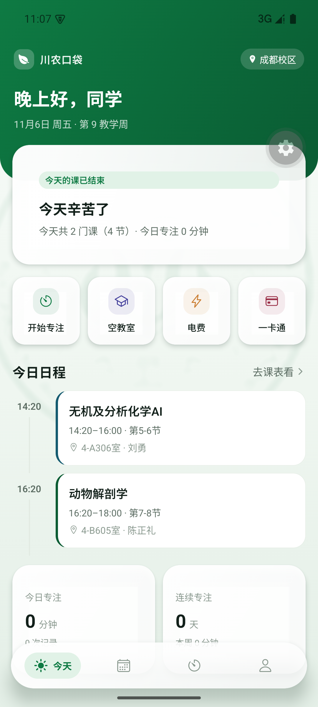 | 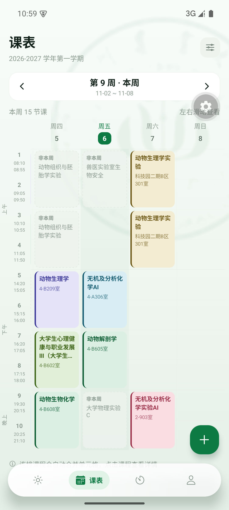 | 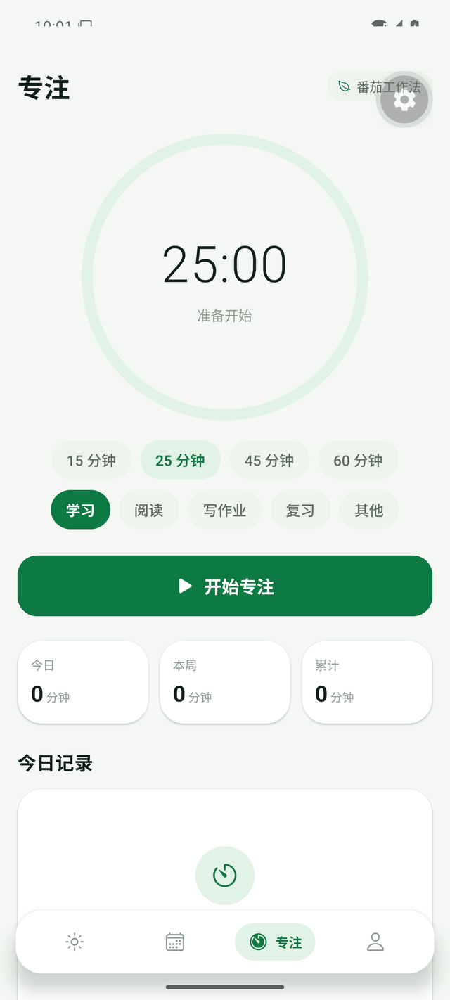 | 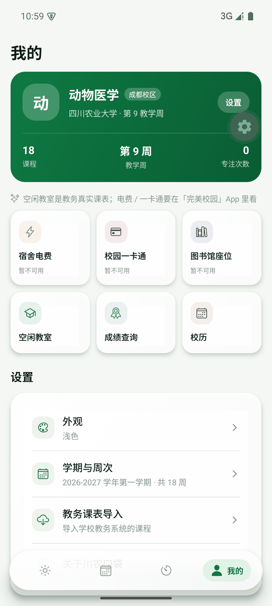 |

深色模式：

| 今天 | 课表 |
| --- | --- |
| 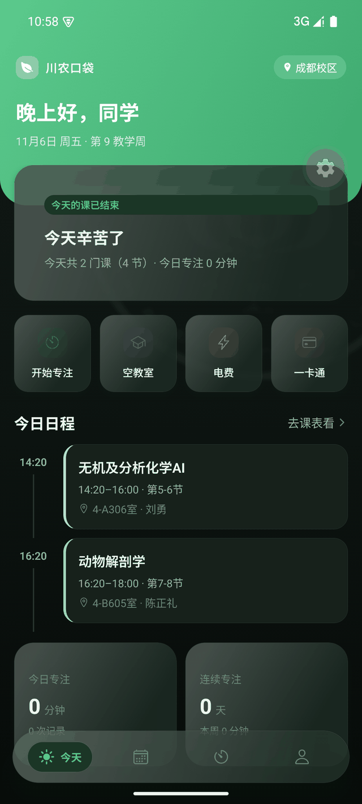 | 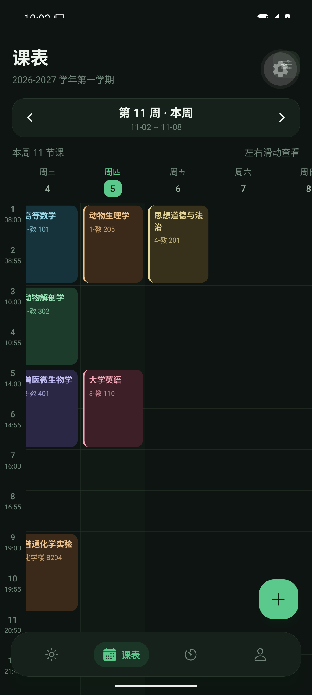 |

校区与导入：

| 导入课表（单入口） | 校区与专业 | 空闲教室（教务真实数据） |
| --- | --- | --- |
| 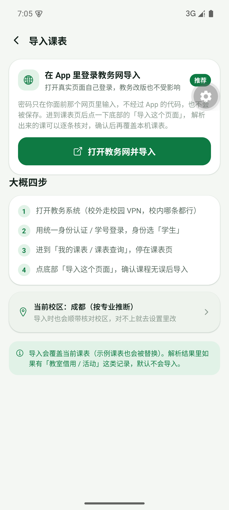 | 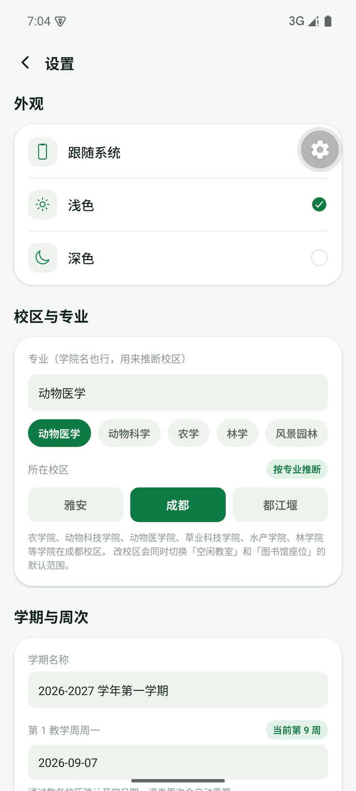 | 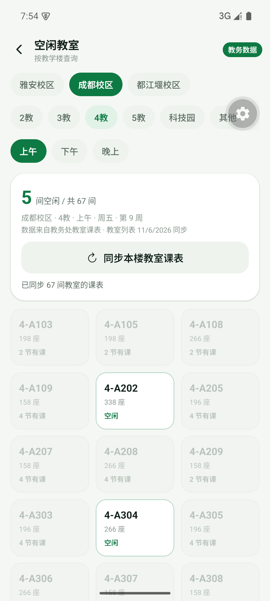 |

| 我的（按专业显示校区） | 电费接完美校园的说明 |
| --- | --- |
| 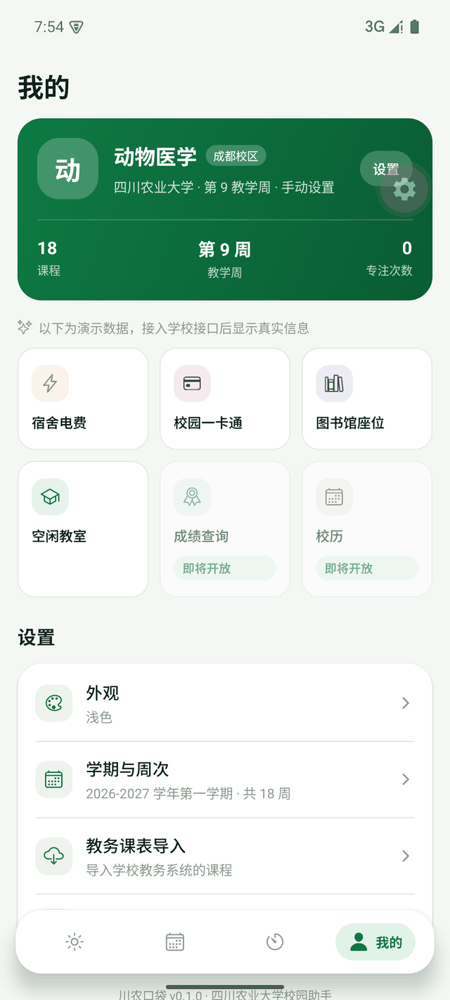 | 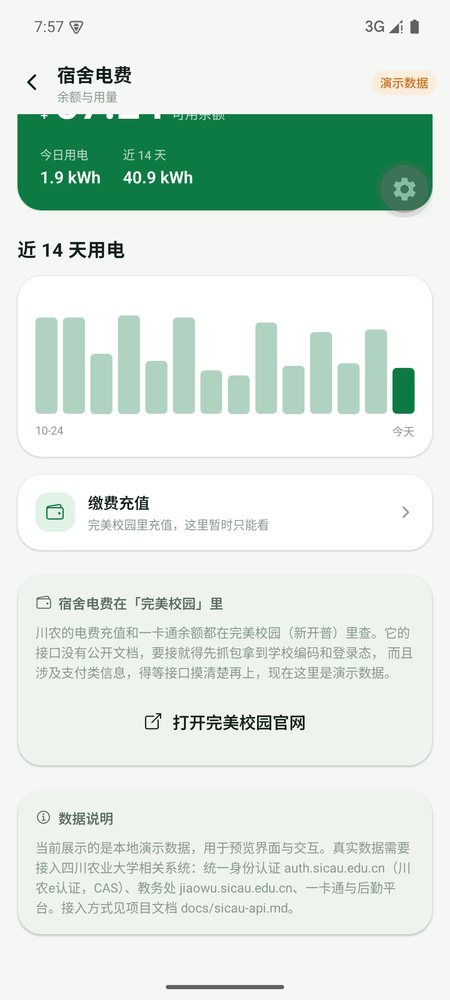 |

导入真实课表：

| 成绩查询（空态） | 导入成绩（内置浏览器） | 校历（含教务网原图） |
| --- | --- | --- |
| 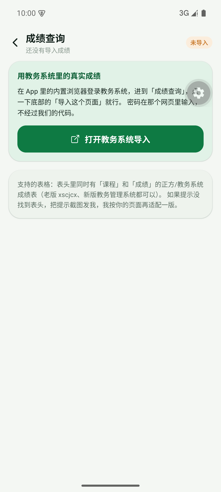 | 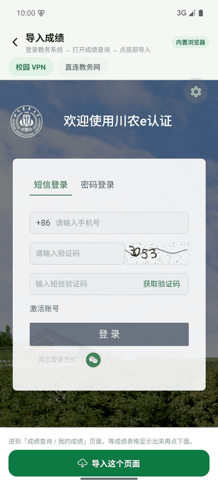 | 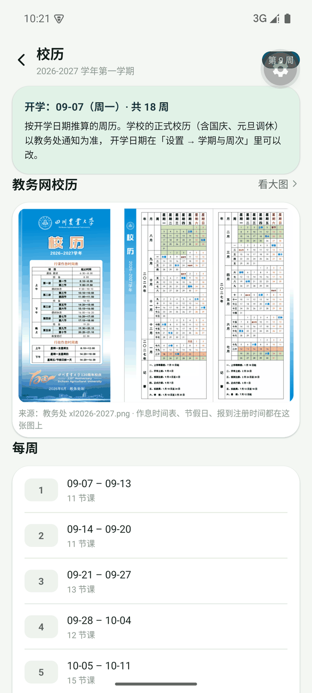 |

| 校区与专业（按专业提醒改校区） |
| --- |
| 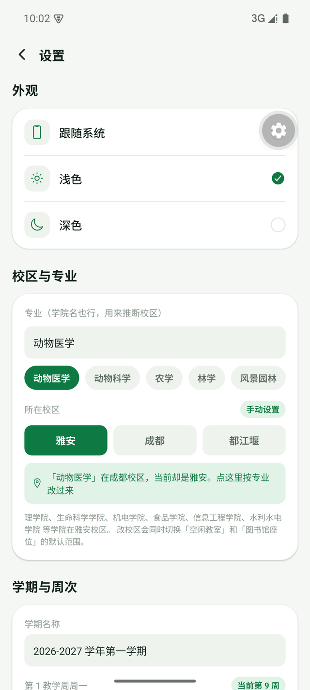 |

| 解析预览 | 导入完成 | 导入后的课表 |
| --- | --- | --- |
| 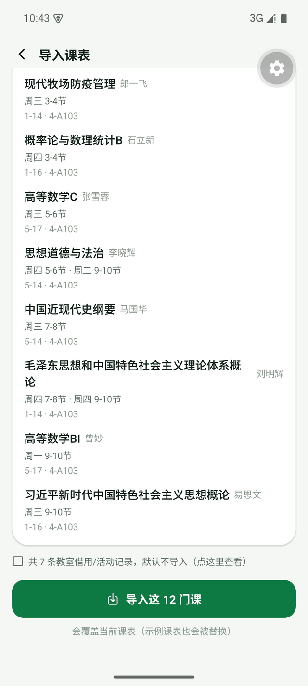 | 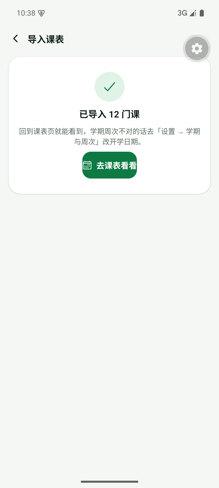 | 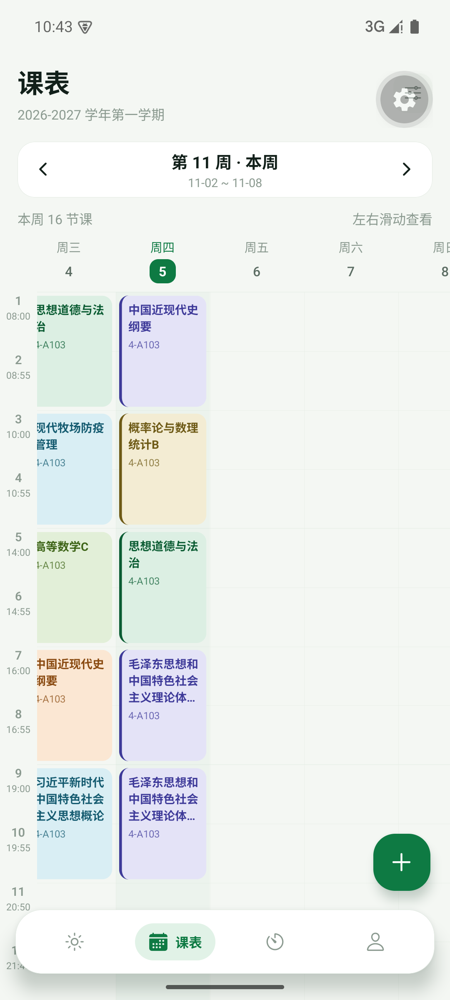 |

## 技术栈

- Expo SDK 58 / React Native 0.88 / React 19
- expo-router（文件路由 + 原生 Stack / Tabs）
- TypeScript 严格模式
- AsyncStorage 本地持久化（无后端）
- react-native-svg（专注环）、expo-linear-gradient（渐变卡片）

## 目录结构

```
app/                    页面（expo-router）
  (tabs)/               底部四个 tab：今天 / 课表 / 专注 / 我的
  course/[id].tsx       课程详情（modal）
  course/edit.tsx       新增 / 编辑课程（modal）
  campus/[kind].tsx     电费 / 一卡通 / 图书馆 / 空教室
  settings.tsx          外观、学期、数据管理
  login.tsx             身份绑定（演示模式）
  about.tsx             关于
components/             UI 套件、悬浮 TabBar、热力图
constants/theme.ts      亮/暗主题、课程色板、间距
lib/                    纯逻辑：课表、日期、节次、番茄钟、统计、演示数据
docs/sicau-api.md       川农各系统接入说明
```


## 界面：玻璃卡片与渐变背景

v0.7.0 起整套 UI 换成「半透明玻璃卡片 + 渐变背景」的风格：

- **玻璃材质**：`components/Glass.tsx` 的 `GlassSurface` —— 模糊层（`expo-blur`）+ 半透明染色 + 顶部镜面高光 + 1px 亮边 + 柔和投影，四层叠出来。卡片、快捷入口、设置列表、悬浮 tab bar 都是这一套。
- **渐变背景**：`components/AppBackground.tsx`，浅色 `#F8FCF9 → #EFF6F0 → #E4EFE7`，深色 `#101815 → #0C1310 → #070B09`；页面滚动时玻璃卡片会透出底下的渐变。
- **校徽水印**：同一个组件里水平垂直居中铺一枚极淡的川农校徽（浅色 9%、深色 7% 不透明度），素材从教务处校历图上裁出来做了透明处理，存在 `assets/images/emblem-green.png` / `emblem-white.png`。
- **主按钮**：绿到深绿的渐变胶囊 + 上半部白色高光，按压有轻微缩放。
- **tab bar**：`borderRadius: 30` 的悬浮胶囊，选中项是一枚带亮边的浅色药丸。

> 安卓上 `expo-blur` 是近似模糊（真实高斯模糊只有 iOS 有），所以安卓的玻璃会略实一点，保证文字可读。


## 导入真实课表

「我的 → 教务课表导入」现在只剩一条路径（`app/web-import.tsx`）：**在 App 里打开真实的教务网，自己登录，停在课表页，点「导入这个页面」**。

为什么不自动登：教务系统的登录方式（密码 / 短信 / 扫码 / 统一身份认证）经常变，而内嵌一个真实浏览器就永远不会过时——学校改版、加验证码、加扫码都不影响导入，密码也只在你面前那个网页里输入。

解析完先给预览（课程名、教师、时段、周次），确认后再覆盖导入；教室借用/活动登记会被自动识别并跳过。

### 校区与专业

首页右上角的「XX 校区」不再是写死的雅安，来源有三个，按优先级：

1. **按课表识别**：学生课表的单元格里写着「成都校区：4-B608」这类前缀，导入时数一下哪个校区出现得最多，自动写进去（`detectCampus()`）；
2. **按专业推断**：「设置 → 校区与专业」里填专业或学院名，按官网「专业设置」表推断（`lib/major.ts`）——
   动物医学 / 动物科学 / 农学 / 林学 / 风景园林 / 经济管理 → **成都**；
   计算机 / 食品 / 水利水电 / 生命科学 / 法学 / 体育 / 艺术 → **雅安**；
   土木 / 建筑 / 商旅（会计、旅游、市营…） → **都江堰**；
3. **手动改**：设置页三个校区按钮，随时覆盖。

改校区会同时切换「空闲教室」的教学楼列表，页面默认跟着你所在校区走。

### 两条通道：校园 VPN / 直连

页面底部有「校园 VPN」「直连教务网」两个开关，默认走 VPN：

- **校园 VPN**：`https://webvpn.sicau.edu.cn/`（网瑞达 wengine）。打开后先跳「川农e认证」登录，
  登录完在门户里点「教务系统」（App 底部也有「进入教务系统」按钮帮你点），
  之后访问的是 `https://webvpn.sicau.edu.cn/https/77726476706e69737468656265737421…/` 这样的代理地址。
  **不在校园网也能用**，出门在外也能导课表。
- **直连教务网**：`https://jiaowu.sicau.edu.cn/`，校园网内最快，登录页和以前一样。
- 两条通道的登录状态分别记住，切换通道不会混用 Cookie。

### 登录状态会被记住

- 会话 Cookie 由系统 WebView 自己持久化（Android Chromium cookie store / iOS `WKWebsiteDataStore`），
  HttpOnly 的 `ASPSESSIONID*` 也在里面，所以关掉 App 再打开不用重新登录。
- 另外把可读的 `document.cookie`、最后停留的课表网址存到 AsyncStorage（`lib/webSession.ts`），
  下次进来先回填，并**直接回到上次那张课表页**。
- 实测：杀掉进程重开，`ASPSESSIONID…` 一模一样，页面直接落在上次的教室课表。
- 想换账号：底部「退出登录」会去点教务页面里的「退出/注销」链接（真登出），
  「清除记住的会话」只清本机记录。

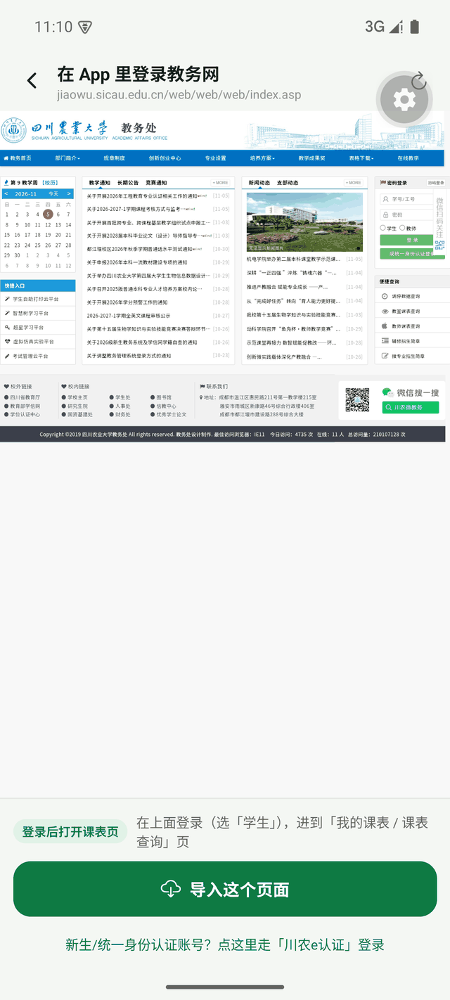
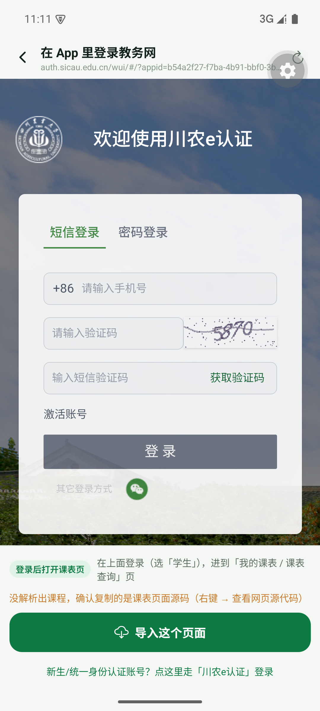
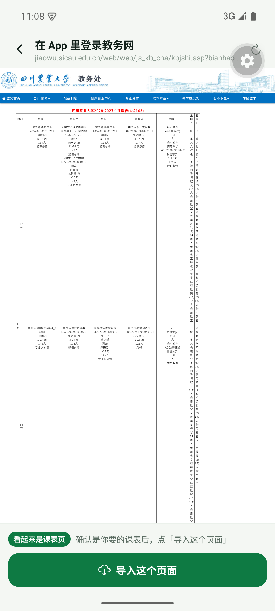

实现细节（GB2312 解码与表单编码、不闭合标签、单元格格式、登录校验、教务要求 `lb=S` 的学生身份）都在
[`docs/sicau-api.md`](docs/sicau-api.md)。

## 数据说明

首次安装会写入一份示例课表（动物医学专业 8 门课），可在「设置 → 导入示例课表」恢复。课表导入会用真实教务数据覆盖本地课表。

电费 / 一卡通 / 图书馆 / 空教室仍是本地生成的演示数据；登录页为「演示模式」，只把学号与姓名写进本机存储。课表导入时的教务密码只在当次请求里使用，不持久化、不写日志。

真实接入需要完成 `docs/sicau-api.md` 里的步骤：CAS 登录拿票据 → 请求教务课表 → 请求一卡通 / 后勤接口。请遵守学校信息系统管理规定，不要高频请求。

## 路线图

- [x] WebView 内打开教务网登录并一键导入课表（川农e认证在 WebView 里正常）
- [x] 记住 WebView 会话与上次的课表页，免重复登录
- [x] 教务课表导入（账号 / 链接 / 源码三种方式，解析正方 ASP 网格课表）
- [x] 桌面小组件（Android AppWidget，4×2 / 2×2 两种）
- [ ] iOS 适配与签名（当前暂不支持）
- [ ] 上课提醒与静音（本地通知）
- [x] 成绩查询（导入式）
- [x] 校历（按开学日期推算 + 教务处官方校历图）
- [ ] 考试安排
- [ ] 深色模式细节打磨、无障碍标签
- [x] 电费余额上主页 + 宿舍房间记忆（可重新选宿舍）

## 免责声明

个人学习作品，与四川农业大学官方无关。示例课程、成绩与消费数据均为虚构，仅用于界面演示。
